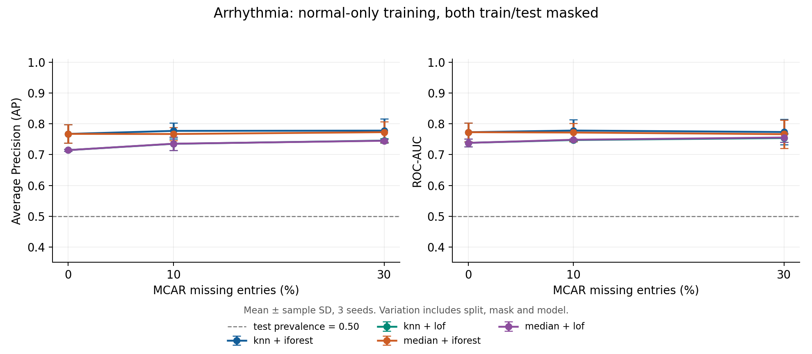
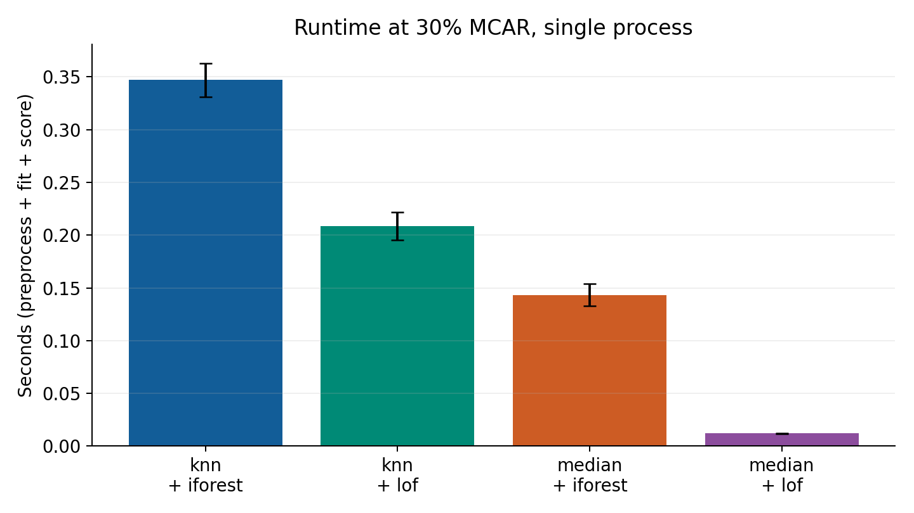

# 缺失数据条件下表格异常检测阶段报告

第八组：刘子杨、纪景瑞、黎博文  
材料日期：2026年10月25日，拟用于10月26日阶段汇报。

## 当前完成情况

本轮已建立可运行的研究工程，完成ImAD官方附带Arrhythmia数据核查，以及中位数/KNN填补与Isolation Forest/LOF组合的传统基础实验。正式轮次共36个配置，覆盖完整数据、10%与30% MCAR和3个种子，全部成功。尚未运行ImAD方法，尚未验证新方法或创新效果。

今晚实际工作由管理员在AI辅助下完成。三人分工为后续拟安排，没有三周已完成的研究记录。

## 研究问题与选题边界

研究一是缺失增加时不同流程如何变化。研究二是在总缺失量相同时，分散缺失与集中于部分特征的缺失有何差异。研究三是无标签扰动稳定性是否有助于诊断流程可靠性，进而考虑轻量融合。第三点必须允许无效或负结果。

我们关注缺失条件下的方法可靠性，不将题目改为评论识别或信用卡欺诈应用。

## 已核实研究与实现成本

MacrOData已在KDD 2026官方页面列为数据集与基准论文。它提供近期基准，并非新的异常检测方法。官方仓库当前有服务器绝对路径，下载函数为TODO。本机HF接口连接超时，因此本轮数据并不来自MacrOData。

ImAD是NeurIPS 2024正式方法论文，研究缺失下异常检测与填补偏差，是计划复现的方法。它涉及联合训练与伪异常生成，实现成本高于传统流程。官方依赖含Linux本地路径，需要独立迁移和核验。本轮只核查了指定正文、附录与代码，未完成方法复现。

M-DEW按已核实的2024预印本记录，已提出填补与预测流程动态加权，其局部能力估计使用阶段2标签误差。SEAOP的摘要及可见片段也提示，扰动稳定性参与异常模型选择已有相关工作。故“动态加权”或“稳定性选择”本身均不足以宣称创新。

具体阅读范围和来源见docs/literature_review.md。综述尚为起稿，不能称为该子领域全面综述。

## 数据与划分

数据来自ImAD作者仓库提交a4963fc976fbb10759717dd6afea51320a5d2639中的data/Arrhythmia/complete_data.npy。文件452行、275列，最后一列标签不进入模型。274维特征中缺失值和无穷值均为0，有17个全局常量特征、0个完全重复特征行，统计仅用于核查。

文件标签为386正常、66异常。按官方代码split=1的数量规则，每个种子用320正常样本训练，测试含66正常与66异常。保存本轮新生成的划分索引，未声称恢复论文未发布的固定索引。测试异常比例为50%，AP不能外推到低异常率应用。

论文表1所列正常320/异常132与实际文件不一致。现保留差异，不把基础实验数值直接当作论文复现。

## 实验协议

先划分，再模拟训练与测试特征的MCAR缺失。种子42、2026、3407同时控制划分、掩码与森林。相同种子与缺失率下，所有方法复用同一掩码，掩码不依赖标签；同种子各缺失比例采用嵌套掩码。

StandardScaler只拟合缺失训练特征并保留NaN，再在缩放空间拟合中位数或KNN填补器。测试仅transform。KNN填补5邻居，LOF20邻居且novelty=True，仅对新测试样本score_samples。Isolation Forest200棵树。分数统一反号为越大越异常。

测试标签仅在最后计算AP和ROC-AUC。AP为average_precision_score，未误标为梯形积分PR-AUC。没有根据测试标签调参、选择融合权重或筛选数据。各检测器先预热一次，报告时间为预处理、拟合与评分之和。

## 实际结果

表中为3个种子的均值±样本标准差，标准差不是置信区间。

|填补|检测|缺失率|AP|ROC-AUC|平均秒数|
|---|---|---|---|---|---|
|knn|iforest|0%|0.7673 ± 0.0302|0.7728 ± 0.0308|0.139|
|knn|iforest|10%|0.7771 ± 0.0261|0.7782 ± 0.0357|0.286|
|knn|iforest|30%|0.7780 ± 0.0378|0.7734 ± 0.0414|0.347|
|knn|lof|0%|0.7147 ± 0.0036|0.7382 ± 0.0126|0.007|
|knn|lof|10%|0.7351 ± 0.0214|0.7473 ± 0.0036|0.144|
|knn|lof|30%|0.7456 ± 0.0072|0.7538 ± 0.0137|0.209|
|median|iforest|0%|0.7673 ± 0.0302|0.7728 ± 0.0308|0.143|
|median|iforest|10%|0.7670 ± 0.0210|0.7717 ± 0.0300|0.150|
|median|iforest|30%|0.7729 ± 0.0341|0.7664 ± 0.0465|0.143|
|median|lof|0%|0.7147 ± 0.0036|0.7382 ± 0.0126|0.009|
|median|lof|10%|0.7355 ± 0.0217|0.7483 ± 0.0031|0.012|
|median|lof|30%|0.7450 ± 0.0047|0.7556 ± 0.0147|0.012|

## 观察与限制

本轮没有出现“缺失越多，指标必定越低”的统一趋势。中位数加Isolation Forest在完整数据与30%缺失下的AP均值分别为0.7673和0.7729，但ROC-AUC均值从0.7728变为0.7664，两个指标的方向不同。中位数加LOF的AP均值从0.7147变为0.7450。

这些是基础流程在一个小型数据集上的观察，不能解释为创新方法提升或缺失有益。少量种子的划分与缺失随机性，以及填补对高维距离的平滑，都可能影响结果，具体原因尚未验证。KNN填补在30%条件下增加了流程耗时，是否值得需要更多数据验证。

本轮仅包含MCAR，同时遮蔽训练与测试，不包含集中缺失、MAR/MNAR、仅测试时缺失、稳定性指标或融合。没有检验稳定性与准确率的关联，因此不能对第三个研究问题给出结论。

## 下一步与验收

第一至二周优先补充近期相关文献，登记第二个数据集，完成ImAD官方方法的小规模运行。随后在统一划分和掩码下扩展到至少2个数据集、5个种子，再对比分散与集中缺失。第四周先做稳定性诊断，只有诊断值得继续时才验证轻量融合，并加入等权基线、塌缩保护及耗时消融。

拟由刘子杨负责文献与统筹，纪景瑞负责数据与缺失模拟，黎博文负责方法与实验。各人交付物和验收标准见docs/plan_and_roles.md。第五周形成完整报告、综述、代码和PPT，第六周只作为缓冲。最终截止日期仍需确认。

如稳定性假设失败，保留负结果，将题目收敛到可靠性评估与稳定性诊断。是否有论文潜力取决于后续证据，不承诺发表。

## 可复查产物

本报告绑定正式运行目录：`reports\runs\20261025_202939_baseline_07f5d4`。该目录保存config.json、environment.json、data_audit.csv、results.csv、summary.csv、paired_differences.csv、划分、掩码、预测分数、run.log、failures.jsonl与protocol_checks.json。

本轮原始文件SHA256：`0ccb314f6a395c5e38d06694ae7fad9f4b7d10ad162cb03d47eb047a26ff1810`。协议检查通过，失败配置数为0。
